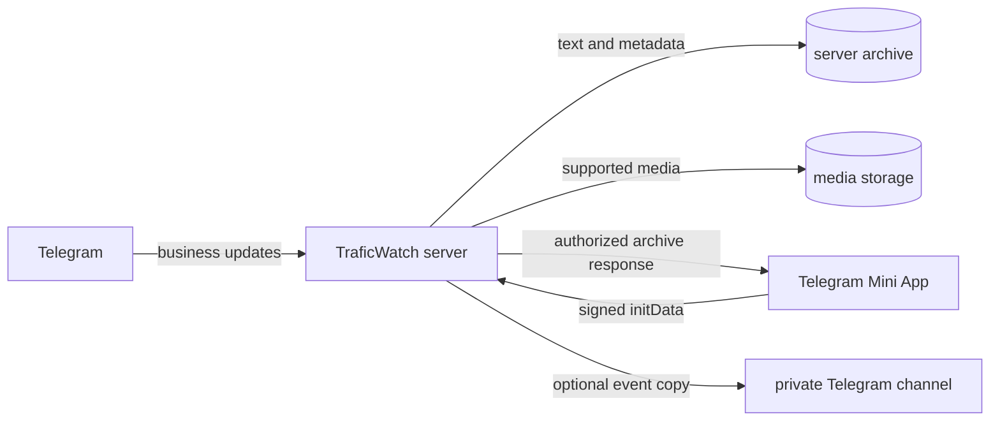

# TraficWatch

> Сообщение удалили. У вас оно осталось.

TraficWatch — сервис для Telegram, который сохраняет новые сообщения из разрешённых чатов, фиксирует доступные события удаления и редактирования, хранит медиа и помогает искать по архиву в Mini App.

[Открыть @TraficWatchBot](https://t.me/TraficWatchBot) · [Сайт](https://enet-dev.ru/) · [Канал](https://t.me/TraficWatch) · [Чат](https://t.me/traficwatchat)

> Этот публичный репозиторий содержит документацию. Исходный код сервиса и инфраструктуры закрыт.

## Что умеет TraficWatch

| Возможность | Что происходит |
|---|---|
| Удалённые сообщения | Если сообщение было получено и сохранено до удаления, его копия остаётся в архиве |
| История правок | CONTROL показывает сохранённые версии текста и время изменений |
| Медиа | Поддерживаемые фото, видео, голосовые и файлы сохраняются с учётом лимитов Telegram Bot API |
| Поиск | Поиск по текущему тексту, сохранённым версиям, удалениям и направлению сообщения |
| Настройки чатов | Сохранение, медиа, уведомления, поиск, личный архив, серии и антискам настраиваются отдельно |
| Личный архив | События можно дублировать в приватный Telegram-канал пользователя |
| Персональные боты | Можно подключить до пяти собственных ботов, созданных через @BotFather |
| Антискам | `/check @username`, `.report` и предупреждения по базе TraficWatch |

## CONTROL 2.0

CONTROL — раздел Mini App для работы с сохранённой историей:

- поиск по архиву и всем сохранённым версиям;
- хронология изменений и удалений;
- переход от результата к сообщению в диалоге;
- отдельные настройки для каждого чата;
- подключение личного архива в приватном канале;
- подключение и контроль персональных ботов.

## Как подключить

Telegram открыл Chat Automation для всех пользователей в мае 2026 года, поэтому Premium не требуется.

1. Откройте [@TraficWatchBot](https://t.me/TraficWatchBot) и нажмите Start.
2. В Telegram откройте профиль → Изменить → Автоматизация чатов.
3. Подключите `@TraficWatchBot` и выберите доступные ему чаты.
4. Убедитесь, что бот прислал подтверждение подключения.

Названия пунктов могут отличаться в разных версиях Telegram.

## Как обращаются данные

- Бот получает только те обновления и чаты, которые Telegram передаёт в рамках выданных прав.
- Архив хранится на сервере TraficWatch. Сервис технически может обработать его содержимое, чтобы показать поиск, версии и медиа.
- Доступ Mini App проверяется по подписанному Telegram `initData` и ограничивается Telegram ID пользователя.
- Токены персональных ботов шифруются на сервере AES-256-GCM под серверным ключом. Это защищает токены в файле конфигурации, но **не является E2E-шифрованием пользовательского архива**.
- Копия в личном Telegram-канале — дополнительный способ хранения, а не отдельная криптографическая гарантия.

TraficWatch не заявляет zero-knowledge или сквозное шифрование архива. Если такая архитектура будет внедрена позже, её следует описывать только после независимой проверки реализации и миграции существующих данных.

## Ограничения

- Архив начинается с момента подключения. Данные, удалённые раньше, восстановить нельзя.
- Сохраняются только сообщения и события, которые Telegram фактически передал боту.
- Доступ зависит от выбранных чатов и прав Chat Automation.
- Секретные чаты и недоступные боту диалоги не архивируются.
- Через стандартный Bot API `getFile` бот может скачивать файлы размером до 20 МБ; поведение больших файлов зависит от инфраструктуры.
- Отключение бота прекращает получение новых событий, но не удаляет уже сохранённый архив.
- Уведомление или архивная копия помогают восстановить контекст, но сами по себе не гарантируют юридическую силу доказательства.
- Отсутствие пользователя в антискам-базе не означает, что он безопасен.

## FAQ

### Нужен ли Telegram Premium?

Нет. С мая 2026 года подключение бота через Chat Automation доступно всем пользователям Telegram.

### Можно ли увидеть сообщение, удалённое до подключения?

Нет. Сервис не может восстановить данные, которые никогда не получал.

### Архив зашифрован ключом, который есть только у меня?

Нет. В текущей реализации архив хранится на сервере и выдаётся после проверки Telegram-авторизации. Не используйте старые формулировки о client-side AES-256-GCM или zero-knowledge для пользовательского архива.

### Как ограничить доступ бота?

Выберите доступные чаты и права при подключении в Telegram, затем используйте настройки отдельных диалогов в CONTROL.

### Как прекратить сохранение?

Отключите бота в настройках Chat Automation. Для удаления ранее сохранённых данных используйте указанный сервисом канал поддержки: `traficwatch@enet-dev.ru`.

### Это официальный сервис Telegram?

Нет. TraficWatch — сторонний сервис, не связанный с Telegram FZ-LLC.

## Контакты

- Бот: [@TraficWatchBot](https://t.me/TraficWatchBot)
- Канал: [@TraficWatch](https://t.me/TraficWatch)
- Чат: [@traficwatchat](https://t.me/traficwatchat)
- Почта: `traficwatch@enet-dev.ru`

Документация распространяется по CC BY 4.0. Telegram является товарным знаком Telegram FZ-LLC.

